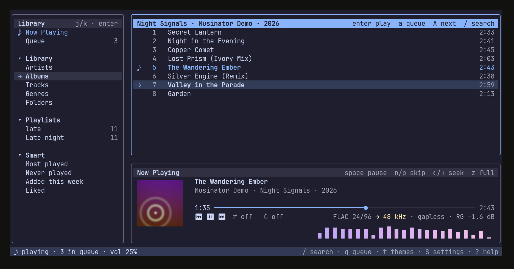
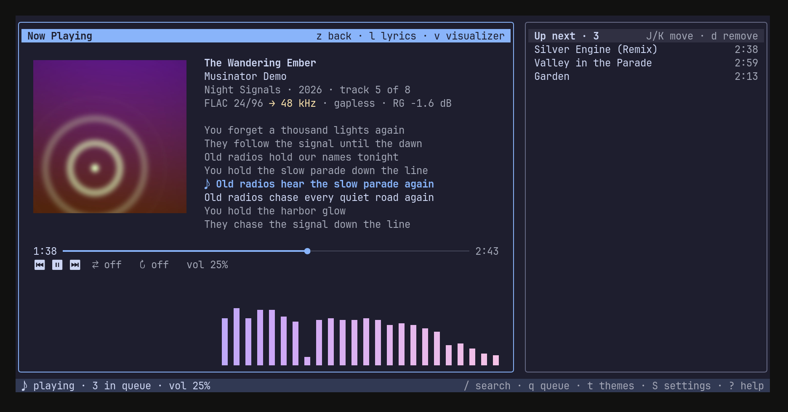
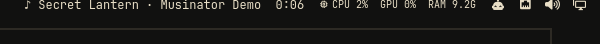
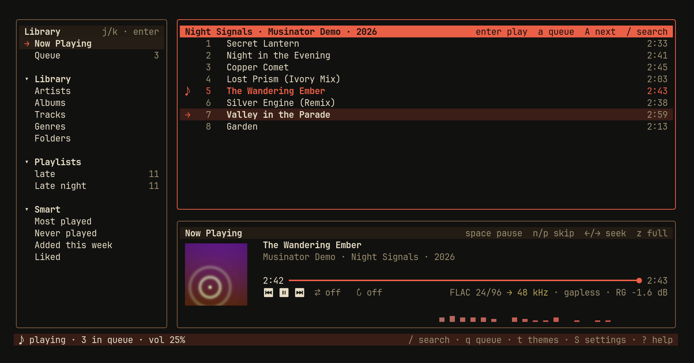
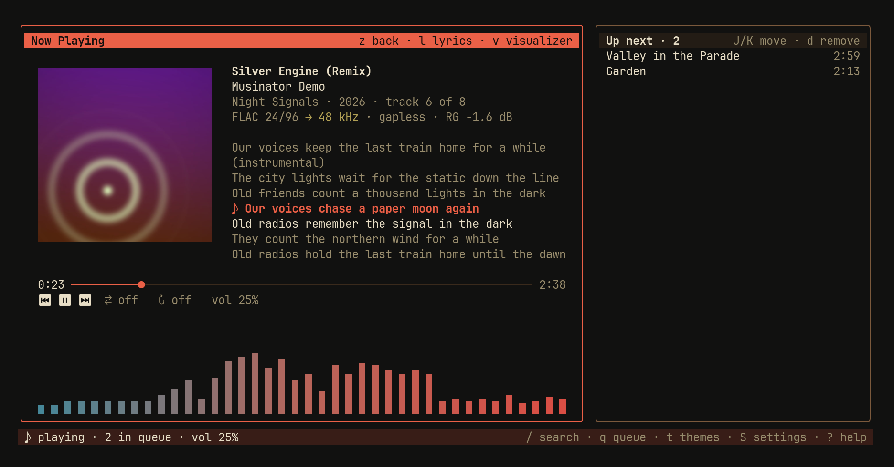

# Musinator

A modern-looking music player for the terminal. Linux and Omarchy first.




## What it does

- Plays your local music: FLAC, MP3, AAC/M4A, ALAC, Ogg Vorbis, Opus, WAV.
- **Gapless.** Songs in the same format flow into each other with no gap, sample-exact (tested for every format).
- **ReplayGain.** Uses track or album gain from tags. Files without tags are measured (EBU R128) in the background.
- **Real format.** The audio line shows codec, bit depth and rate, e.g. `FLAC 24/96 → 48 kHz · gapless · RG −1.6 dB`. `→ 48 kHz` means PipeWire resamples. `bit-perfect` means it does not.
- **Real album art** on Kitty and Ghostty. Half-blocks in other terminals.
- Visualizer from the real audio, synced lyrics (`.lrc`, embedded, or looked up on [LRCLIB](https://lrclib.net) when you press `ctrl+l`; found lyrics are cached, or saved next to the song if you turn that on in Settings → Library), playlists (`.m3u8` import/export), search, smart lists.
- [Last.fm](https://www.last.fm) scrobbling: log in once in **Settings → Desktop → Last.fm account** (your browser opens; your password never goes through Musinator). Shows "now playing", and counts a song after half of it or 4 minutes (Last.fm's rule). Scrobbles wait while offline and are sent later. Radio songs count too when the station names them (can be turned off). A **Last.fm** section in the sidebar shows your Recent and Loved songs and your Top artists / songs (week, month, year, all time); songs in your library play from there. `L` (like) also loves the song on Last.fm. Now Playing shows `last.fm`, then `last.fm ✓` once the song counts, and how many scrobbles wait while offline.
- Music servers: [Navidrome](https://www.navidrome.org), [Jellyfin](https://jellyfin.org) and other Subsonic servers (Gonic, Airsonic, Ampache, …); Musinator finds out which kind it is. Set up in **Settings → Library → Music server**; only a login token is stored, never your password. Artists, Albums, Recently added and Playlists show in the sidebar, the main search (`/`) finds server songs too, songs stream in their original quality with seeking, and plays are reported to the server and Last.fm.
- Podcasts: find shows in the Apple Podcasts directory (free, no account) or add a feed address, `L` subscribes. Episodes stream with seeking, or `D` downloads them (all in Podcasts → Downloads; the newest of each show downloads by itself; can be turned off). Musinator remembers where you stopped in each episode and marks finished ones as played.
- Internet radio from [radio-browser.info](https://www.radio-browser.info) (free, no account): Popular, Genres, Countries, the main search (`/`) also finds stations by name, genre or country, your Favorites (`L` on a station), and your own stations by web address (also `.pls`/`.m3u` links). Shows the song on air. Musinator only asks radio-browser.info when you open these lists.
- 22 themes plus **Match Omarchy**, which follows your Omarchy theme live. Every theme passes a contrast test.
- Media keys and `playerctl` (MPRIS). A module for the Omarchy bar or Waybar.
- Every setting is in the app. Every key can be changed.
- Star ratings, a sleep timer, and it resumes the queue and position where you left off (paused).
- Light: about 0% CPU when idle, under 1% while playing with the visualizer.

## Install

**Arch / Omarchy (AUR):**

```sh
yay -S musinator-bin
```

**Script** (installs to `~/.local/bin`, no sudo):

```sh
curl -fsSL https://raw.githubusercontent.com/smanookian/musinator/main/install.sh | sh
```

**From source:**

```sh
git clone https://github.com/smanookian/musinator && cd musinator && ./install.sh
```

Needs PipeWire and libopus (`sudo pacman -S pipewire opus`). Building needs Rust, clang and `libpipewire` headers.

Then run `musinator`. It scans `~/Music` in the background. Add other folders in **Settings → Library**.

## Screens

- **Library** (A): sources on the left, the list in the middle, now playing at the bottom.
- **Now Playing** (B): big cover, lyrics, visualizer, up next.
- `z` switches between them. `esc` goes back.

## Keys

All keys can be changed in **Settings → Keys**. Press `?` for searchable help.

**Mouse:** click the player buttons (⏮ ⏸ ⏭, shuffle, repeat), the progress bar, any key hint (for example `a queue` or `/ search`) and rows in lists and windows. Click a selected row again to open it; the wheel scrolls.

| Key | Action |
|-----|--------|
| `ctrl+f` | filter the open list: type to narrow it (all words, any order); `enter` opens, `esc` shows everything again |
| `esc` / `backspace` | back to the previous list (or click the `‹` title) |
| `space` | play / pause |
| `enter` | play selected / open |
| `n` / `p` | next / previous |
| `←` / `→` | seek −5 s / +5 s |
| `shift+←` / `shift+→` | seek −30 s / +30 s |
| `+` / `-` | volume |
| `s` / `r` | shuffle / repeat (off, all, one) |
| `a` / `A` | add to queue / play next |
| `J` / `K` / `d` | move down / up / remove (queue, playlists) |
| `X` | clear queue |
| `/` | search everything |
| `z` | Library ↔ Now Playing |
| `l` / `v` | lyrics / visualizer on or off |
| `q` | queue |
| `t` | themes (previews live, `esc` undoes) |
| `S` | settings |
| `?` | help |
| `tab` | next pane |
| `j` / `k`, `g` / `G` | move, top / bottom |
| `<` / `>` | left pane narrower / wider |
| `o` | album grid |
| `P` / `N` | add to playlist / new playlist |
| `R` / `E` | rename / export playlist |
| `L` | like |
| `1`–`5` / `0` | rate 1–5 stars / clear rating |
| `e` | edit tags of the song, or of every song in an album / folder. `ctrl+f` fills tags from the file and folder name. **Cover:** type a picture path (JPEG/PNG kept as is, other formats become JPEG); it goes inside every song, and for an album also as `cover.jpg` in the folder. `ctrl+x` removes it. **`ctrl+b`** looks the album up on [MusicBrainz](https://musicbrainz.org): pick the release, and it fills titles, artist, album, year, track and disc numbers, plus the front cover from the [Cover Art Archive](https://coverartarchive.org). Only artist and album names are sent, and only when you press it. Nothing is saved until you press `enter`. Musinator writes a copy first, then replaces the file. |
| `ctrl+e` | equalizer: 10 bands with a live curve, presets (Rock, Pop, Jazz, …) or your own; `space` on/off. Boosts lower the overall level so nothing distorts. |
| `V` | watch a video file (`mp4`, `mkv`, `webm`, …) in [mpv](https://mpv.io) from the same spot; Musinator pauses |
| `m` | mini mode: 3 lines for a small window (turns on by itself when the window is small) |
| `f` | full-screen lyrics (big current line on Kitty/Ghostty) |
| `ctrl+l` | find lyrics online (LRCLIB), only when you press it |
| `[` / `]` | lyrics 0.5 s earlier / later for this song (saved per song) |
| `ctrl+t` | sleep timer (minutes, end of song, end of album) |
| `ctrl+r` | rescan music folders |
| `Q` or `ctrl+c` | quit (asks first; turn that off in Settings → Playback) |

## Command line

```sh
musinator play | pause | toggle | next | prev | stop
musinator status          # ▶ Night Drive — Neon Harbor  2:11 / 5:37  (FLAC 24/96 → 48 kHz, vol 70%)
musinator status --json   # full status as JSON
musinator --bar           # one line of JSON for the Omarchy bar or Waybar
```

These talk to the running app. `--bar` prints an empty line when nothing plays, so the module hides.

**Omarchy bar:** turn on **Settings → Desktop → Show in Omarchy bar**. Musinator adds its module to
`~/.config/omarchy/shell.json` (it keeps a backup in `shell.json.bak-musinator`) and removes it when you
turn it off.

**Waybar:**

```jsonc
"custom/musinator": { "exec": "musinator --bar", "return-type": "json", "interval": 2 }
```



## Audio notes

- Musinator talks to PipeWire directly and opens the stream at the file's own rate.
- By default PipeWire runs at one rate (often 48 kHz) and resamples the rest. Musinator shows this honestly.
- **Settings → Audio → PipeWire rate switching** lets PipeWire switch to the file's rate. It writes
  `~/.config/pipewire/pipewire.conf.d/50-musinator.conf` and applies it at once. Turn it off to remove the file.
  PipeWire only switches when no other app is playing at another rate.
- `bit-perfect` shows when the rates match, the volume is 100% and no ReplayGain is applied.
- ReplayGain modes: auto (album gain when you play an album, else track), track, album, off. Preamp and clipping
  protection are in **Settings → Audio**. `RG` means the gain came from tags, `R128` means Musinator measured it.

## Themes

Catppuccin (Mocha, Macchiato, Frappé, Latte), Tokyo Night (Night, Storm, Day), Rosé Pine (Main, Moon, Dawn),
Gruvbox (Dark, Light), Nord, Dracula, One Dark, Solarized (Dark, Light), Kanagawa Wave, Everforest Dark,
Ayu Mirage, GitHub (Dark, Light), and **Match Omarchy**.

Text has at least 4.5:1 contrast and borders and the selection marker at least 3:1, in every theme
(checked by `cargo test`).

| Catppuccin Mocha | Match Omarchy (Retro Stripes) |
|---|---|
|  |  |
|  |  |

More: [search](docs/screenshots/search-catppuccin.png) ·
[settings](docs/screenshots/settings-catppuccin.png) ·
[theme preview](docs/screenshots/theme-picker-preview.png) ·
[album grid](docs/screenshots/album-grid-catppuccin.png) ·
[half-blocks in foot](docs/screenshots/halfblocks-foot.png) ·
[bit-perfect](docs/screenshots/bit-perfect.png) ·
[Omarchy theme switch: before](docs/screenshots/omarchy-before.png) / [after](docs/screenshots/omarchy-after-live-switch.png)

## Lyrics timing

Like karaoke apps, Musinator shows the next line a little before it is sung (Settings → Appearance → Lyrics lead time, default 0.3 s). The lyric clock follows what you hear: it subtracts PipeWire's output delay. If one song is still off, `[` / `]` fix that song.

Lyrics with word times ("enhanced LRC", e.g. `[01:00.91]<01:00.91> You <01:01.21> got`) light up word by word, like karaoke: each word fills when it is sung.

## Files

- Settings: `~/.config/musinator/config.toml` (you never need to edit it)
- Library database: `~/.local/share/musinator/library.db`
- Cover cache: `~/.cache/musinator/art`

## Development

```sh
cargo test --workspace                         # gapless per format, contrast per theme, library, keys, settings
cargo run --release -p testlib -- --tracks 10000   # 10,000+ test files in ~/Music/Musinator Test Library
cargo run --release -p testlib -- --clean          # remove them
```

## Credits

The look and feel borrows ideas from Allison's Tide apps ([tide](https://github.com/allisonhere/tide),
[tidemail](https://github.com/allisonhere/tidemail), [tideui](https://github.com/allisonhere/tideui)).
No code was copied. Theme colors come from the published palettes of each theme project.

## License

MIT
